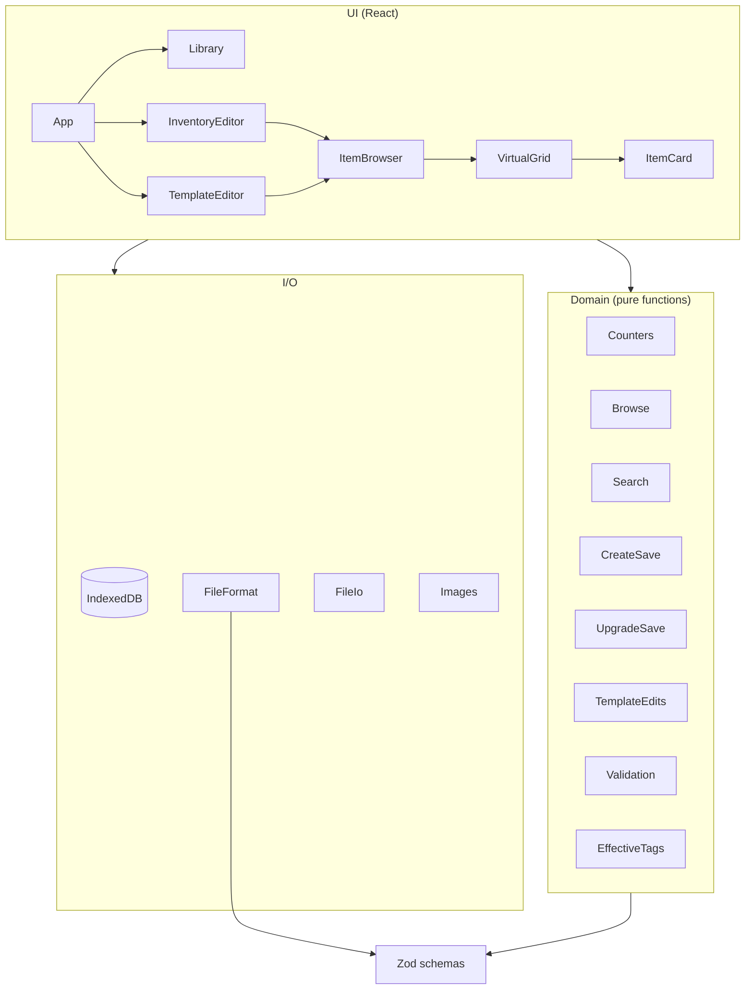
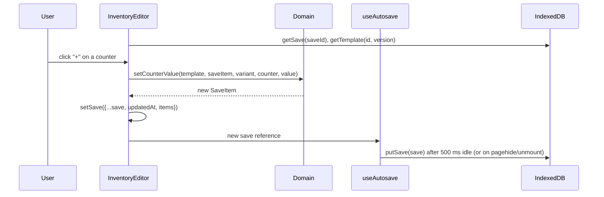

# Game Item Tracker: Technical Manual

This manual is for programmers and AI coding agents working on the code. It describes how the app is built, where things live, what must stay true, and how to make common changes.

- End-user documentation: [USER_MANUAL.md](USER_MANUAL.md) (with screenshots).
- Original design and its reasoning: [PLAN.md](PLAN.md).
- Contribution rules: [AGENTS.md](../AGENTS.md).

## Quick facts

| Topic | Value |
|---|---|
| App type | Client-only PWA. No backend, no network calls at runtime. |
| Hosting | GitHub Pages at `https://vpksoft.github.io/game-item-tracker/` |
| Stack | React 19, TypeScript, Vite, Ant Design 6, styled-components, vite-plugin-pwa |
| Localization | i18next + react-i18next (`src/Localization`): English (default) and Finnish |
| Data validation | Zod 4 (`src/Schemas`) |
| Storage | IndexedDB through `idb` (`src/Storage/Database.ts`); localStorage for UI preferences only |
| Search | Fuse.js (`src/Domain/Search.ts`) |
| Grid | `@tanstack/react-virtual` (`src/Components/VirtualGrid.tsx`) |
| Tests | Vitest + jsdom + Testing Library + fake-indexeddb |
| Lint/format | Biome (`biome.json`) |
| Node | 26.x (CI) |
| Default branch | `develop`. All changes go through pull requests. |
| Required checks | `npm run lint`, `npx tsc -b`, `npm test` |

## Contents

1. [Domain model](#1-domain-model)
2. [Repository layout](#2-repository-layout)
3. [Architecture](#3-architecture)
4. [Data formats](#4-data-formats)
5. [Domain logic](#5-domain-logic)
6. [Storage and persistence](#6-storage-and-persistence)
7. [Files: import and export](#7-files-import-and-export)
8. [Images](#8-images)
9. [UI](#9-ui)
10. [Sample templates (Palia)](#10-sample-templates-palia)
11. [Testing](#11-testing)
12. [Build, CI and conventions](#12-build-ci-and-conventions)
13. [Invariants](#13-invariants)
14. [How-to recipes](#14-how-to-recipes)
15. [Design history](#15-design-history)
16. [Known limitations](#16-known-limitations)

---

## 1. Domain model

The app has two document types. Keeping them apart is the central design decision.

| | Template | Save |
|---|---|---|
| Purpose | What exists in a game | What one user owns |
| Edited in | `src/Views/TemplateEditor.tsx` | `src/Views/InventoryEditor.tsx` |
| Identity | `templateId` (UUID) + `version` (semver) | `saveId` (UUID) |
| File extension | `.gitemplate.json` | `.gisave.json` |
| `format` field | `game-item-tracker/template` | `game-item-tracker/save` |
| Schema | `src/Schemas/TemplateSchema.ts` | `src/Schemas/SaveSchema.ts` |

A save references exactly one template version (`save.template.templateId` + `save.template.version`). It stores **only user data**: counter values, obtained marks, notes and tag differences. Names, descriptions, images, attributes and counter definitions are always looked up from the template by stable ids. This makes saves small and makes template upgrades possible without copying data.

Template building blocks:

| Concept | Type | Notes |
|---|---|---|
| Category | `Category` | Tree through optional `parentId`. Selecting a parent in the browser includes its children. |
| Item | `TemplateItem` | Stable `id` (slug). Never reuse an id for a different item. |
| Attribute | `AttributeDef` | Read-only numbers in saves (e.g. rarity 1–5), optional named `levels` with colors. |
| Counter | `CounterDef` | `manual` (user edits) or `computed` (sum of manual counters). Optional role `owned` / `target`, optional `variants` limit, optional `max`. |
| Variant | `VariantDef` | Splits an item's amounts into rows, e.g. `normal` and `starred` fish. |
| Unique | `TemplateItem.unique` | `true` (whole item) or a list of variant keys. A unique variant has an obtained flag instead of counters. |
| Tag | `string` | Vocabulary in `template.tags`, per item in `item.tags`. |
| Image | `template.images` | `imageId → data URL`, deduplicated by content hash. |

## 2. Repository layout

```
src/
  Main.tsx                 Entry point: StrictMode → AntdThemeProvider → antd App → App
  App.tsx                  Toolbar, view switching (Inventory | Templates | Library), dark mode, settings
  Schemas/                 Zod schemas and inferred types (single source of truth for data shapes)
    TemplateSchema.ts
    SaveSchema.ts
  Domain/                  Pure functions, no React, no I/O. Most logic and tests live here.
    Counters.ts            Variants, counter evaluation, roles, unique/obtained, missing
    CreateSave.ts          createSave, createSaveItem, createTemplate
    UpgradeSave.ts         upgradeSave (template version migration of a save)
    TemplateEdits.ts       Immutable template edit operations (upsert/delete/rename/move…)
    Validation.ts          validateTemplate: cross-reference checks beyond the Zod shape
    Browse.ts              Filtering + sorting for the item grid, sort options
    Search.ts              Fuse.js index and query
    EffectiveTags.ts       Tag difference model (template tags − removed + custom)
    Ids.ts                 slugify, uniqueId, newUuid, bumpVersion, compareVersions
    TestFixtures.ts        Shared fixtures for tests
  Storage/
    Database.ts            IndexedDB schema and CRUD
    UseAutosave.ts         Debounced save hook with flush on page hide/unmount
  Files/
    FileFormat.ts          Extensions, parseFileText (format detection + Zod), serialize
    FileIo.ts              downloadFile (File System Access API or download link), readFileText
  Images/
    ImageInput.ts          File from drag-and-drop / clipboard
    ImageResize.ts         Validation, resize to 128 px WebP, size limits, hashing
  Components/              Reusable UI pieces
    ItemBrowser.tsx        Shared toolbar (category, search, sort, filters) + grid
    VirtualGrid.tsx        Virtualized responsive card grid
    ItemCard.tsx           Item card and CounterRows (counter steppers / obtained checkbox)
    CounterStepper.tsx     "− [n] +" input; shift-click = ±10
    AttributeBadges.tsx, TagEditor.tsx, ImageDropZone.tsx, ImagePreviewDialog.tsx
    UseSearchIndex.ts      Rebuilds the Fuse index only when searchable text changes
  Views/                   Screens
    Library.tsx            Lists, import/export, create, delete
    InventoryEditor.tsx    Save editor
    SaveItemDrawer.tsx     Save item details (amounts, tags, notes)
    TemplateEditor.tsx     Template editor with tabs
    TemplateItemDrawer.tsx Template item editor (incl. unique, defaults, image)
    StructureEditors.tsx   Categories, variants, attributes, tags tabs
    CountersEditor.tsx     Counters tab
    UpgradeDialog.tsx      Save upgrade preview
  Localization/
    I18n.ts                i18next setup, supported languages, stored language, setLanguage
    I18next.d.ts           Type augmentation: translation keys are checked by tsc
    Messages.ts            translateMessage / translateError for coded messages from non-UI code
    Locales/En.ts          English texts (reference language; defines the Translation type)
    Locales/Fi.ts          Finnish texts (typed as Translation)
  Popups/                  AboutPopup.tsx, SettingsPopup.tsx (language)
  Types/LocalizedMessage.ts  LocalizedMessage, LocalizedError, createMessage, formatMessage
  Context/AntdThemeContext.tsx   Light/dark theme and antd locale at runtime
  Utilities/UseLocalStorage.tsx  JSON localStorage helper
  TestSetup.ts             jest-dom, fake-indexeddb, matchMedia/ResizeObserver stubs
scripts/
  BuildPaliaTemplates.ts   Node CLI: builds the Palia sample templates from the wiki
  PaliaParsers.ts          HTML table parsers and template builders (pure, tested)
  PaliaParsers.test.ts
docs/
  PLAN.md                  Design document (implemented)
  USER_MANUAL.md           End-user manual
  TECHNICAL_MANUAL.md      This file
  images/manual/           Screenshots for the user manual
```

Sample data is **not** in this repository. It lives in the separate template repository `game-item-tracker-data` (one folder per first letter, then per game: `P/Palia/`). `npm run build-samples` writes to `../game-item-tracker-data/P/Palia` by default.

## 3. Architecture



Layering rules:

- `Schemas` depends on nothing but Zod. Types are inferred from the schemas (`z.infer`); do not declare parallel hand-written types.
- `Domain` contains pure, synchronous functions that take and return plain data. They never mutate their input; every edit returns a new object. No React, no IndexedDB, no DOM.
- `Storage`, `Files` and `Images` do I/O.
- `Views` own document state; `Components` are reusable and get data through props.

### 3.1 State flow

There is no global store. Each editor view loads its document into `React.useState` and writes it back with `useAutosave`.



- `InventoryEditor`: `useAutosave(save, putSave)` with the default 500 ms delay. It also finds the newest stored version of the save's template to offer an upgrade.
- `TemplateEditor`: `useAutosave(template, putTemplate, 1500)`. Templates can carry megabytes of images, so they are written less often.
- Before exporting, the views call the `flush()` returned by `useAutosave` so the stored copy matches the file.

`App.tsx` keeps the current view, open save id and open template key in localStorage (`view`, `openSaveId`, `openTemplate`, `darkMode`). The UI language is stored under `language` by `Localization/I18n.ts`. `ItemBrowser` remembers category/sort/filters per document under `browser:save:<saveId>` and `browser:template:<templateId>`.

## 4. Data formats

All files are UTF-8 JSON, pretty-printed with two spaces (`serialize`). Every file has `format` and `schemaVersion` (currently `1` for both). The schemas in `src/Schemas` are authoritative; this section summarizes them.

### 4.1 Template

```ts
type Template = {
    format: "game-item-tracker/template";
    schemaVersion: 1;
    templateId: string;          // UUID, stable across versions
    version: string;             // "MAJOR.MINOR.PATCH"
    game: string;
    name: string;
    description?: string;
    updatedAt: string;           // ISO 8601
    attributeDefs: AttributeDef[];
    counterDefs: CounterDef[];
    variantDefs: VariantDef[];
    tags: string[];              // tag vocabulary
    categories: Category[];
    items: TemplateItem[];
    images: Record<string, string>;            // imageId -> data URL (WebP/PNG)
    source?: { name: string; url: string; license?: string };
};

type AttributeDef = {
    key: string; label: string; min: number; max: number; step?: number;
    levels?: { value: number; label: string; color?: string }[];
};

type CounterDef = {
    key: string; label: string;
    kind: "manual" | "computed";
    sumOf?: string[];            // computed only: keys of MANUAL counters
    role?: "owned" | "target";   // at most one counter per role
    variants?: string[];         // omitted = applies to all variants
    max?: number;                // manual only, integer >= 0
    order: number;
};

type VariantDef = { key: string; label: string; order: number };

type Category = { id: string; name: string; order: number; parentId?: string };

type TemplateItem = {
    id: string; categoryId: string; name: string; description: string;
    imageId?: string;
    attributes: Record<string, number>;
    tags: string[];
    variants?: string[];         // omitted = all variantDefs
    defaults?: Record<string, number>;   // manual counter key -> initial value in new saves
    unique?: true | string[];    // true = every variant unique; list = those variant keys
    deprecated?: boolean;        // removed from the game, kept for old saves
};
```

Keys and ids (`key`, `id`, `categoryId`, `parentId`, variant keys) must match `/^[a-z0-9][a-z0-9_-]*$/i`.

### 4.2 Save

```ts
type Save = {
    format: "game-item-tracker/save";
    schemaVersion: 1;
    saveId: string;
    name: string;
    template: { templateId: string; version: string; name: string; game: string };
    updatedAt: string;
    items: Record<string /* itemId */, SaveItem>;
    bundle?: Template;           // optional embedded template ("Export with template")
};

type SaveItem = {
    counts: Record<string /* variantKey or "_" */, Record<string /* counterKey */, number>>;
    notes: string;
    removedTags: string[];       // template tags the user removed
    customTags: string[];        // tags the user added
    obtained?: string[];         // variant keys ("_" when no variants) of obtained unique variants
    orphan?: { name: string };   // item no longer in the template; keeps a display name
};
```

- Computed counters are **never stored**. They are evaluated on read.
- Items of a template without `variantDefs` use the variant key `"_"` (`noVariantKey` in `Counters.ts`).
- Missing entries mean 0 / empty. Code must use `getSaveItem(save, id)` or handle `undefined`.
- `obtained` is omitted when empty, and `orphan` is removed when undefined, to keep files small and diffs stable.
- `bundle` is never stored in IndexedDB (`putSave` strips it); on import it is stored as a template if that version is missing.

### 4.3 Example (fish item with a unique starred variant)

Template item:

```json
{
    "id": "ancient-cloudminnow",
    "categoryId": "temple-of-the-gales",
    "name": "Ancient Cloudminnow",
    "description": "A legendary minnow ...",
    "imageId": "3f2a...",
    "attributes": { "rarity": 5 },
    "tags": ["location:Temple of the Gales", "time:Any time", "bait:No bait", "quest:Main Quest"],
    "unique": ["starred"]
}
```

Save item:

```json
{
    "counts": { "normal": { "inventory": 1, "target": 2, "tradeable": 1 } },
    "notes": "Caught during rain.",
    "removedTags": [],
    "customTags": [],
    "obtained": ["starred"]
}
```

## 5. Domain logic

### 5.1 Variants and counters (`Counters.ts`)

| Function | Behavior |
|---|---|
| `getItemVariants(template, item)` | Variants that apply to the item in `order`. Without `variantDefs`: one anonymous variant `"_"`. |
| `counterAppliesTo(counter, variantKey)` | `true` when `counter.variants` is empty/omitted or contains the key. |
| `getVariantCounters(template, variantKey)` | Counters shown for a variant, sorted by `order`. |
| `findRoleCounter(template, role)` | The counter with role `owned` or `target`. |
| `getCounterValue(template, saveItem, variant, counter, item?)` | Manual: stored value or 0. Computed: sum of its `sumOf` manual counters that apply to the variant. Unique variant (needs `item`): owned-role counter = 1 if obtained else 0, target-role counter = 1, all others 0. |
| `getItemCounterTotal(...)` | `getCounterValue` summed over the item's variants. Used by counter sorts and the *counter above zero* filter. |
| `getMissing(template, item, saveItem)` | Σ over variants of `max(0, target − owned)`; `undefined` if either role is missing. |
| `clampCounter(def, value)` | Rounds; clamps to `[0, max]`. |
| `setCounterValue(...)` | Sets a manual counter; ignores computed counters and counters that don't apply to the variant. |
| `isVariantUnique(item, variantKey)` | `item.unique === true` or the list contains the key. |
| `hasUniqueVariants(template, item)` | Any of the item's variants is unique. |
| `isObtained` / `setObtained` | Read/write `saveItem.obtained`. `setObtained` removes the field when it becomes empty. |
| `commonCounters()` | Preset: Inventory, Placed, Storage, Total (= Inventory + Placed + Storage, owned), Target (target), Tradeable. |

Why computed counters are limited to sums of manual counters: no cycles, no evaluation order, no formula parser. If weights or subtraction are ever needed, extend `CounterDef` and `getCounterValue` together with `validateTemplate`.

### 5.2 Unique items

Added after the initial release (PR #2). The request was: an item can be marked unique in the template; its counters are then disabled in the save and the user can mark it obtained. The Palia example: the **starred** Ancient Cloudminnow is unique, the normal one is not.

Design:

- `TemplateItem.unique?: true | string[]`, so either the whole item or chosen variants are unique.
- `SaveItem.obtained?: string[]` stores the obtained variant keys (`"_"` for items without variants).
- A unique variant behaves as **target 1, owned 1 when obtained** in `getCounterValue`. Progress bars, `getMissing`, sorting and filters therefore work without special cases.
- `createSaveItem` does not write defaults for unique variants.
- `deleteVariant` removes the variant from `unique` lists too.
- `upgradeSave` treats `obtained` as user data and, with `discardHidden`, drops obtained keys of removed variants.
- `validateTemplate` reports unique keys that are unknown or not among the item's variants.
- UI: `CounterRows` in `ItemCard.tsx` renders a checkbox and a gold *Unique* tag instead of steppers; `TemplateItemDrawer.tsx` has the *Unique* switch and variant checkboxes.
- The Palia generator marks the starred Ancient Cloudminnow unique (`uniqueStarredFish` in `PaliaParsers.ts`).

### 5.3 Tags (`EffectiveTags.ts`)

Effective tags = `(item.tags − saveItem.removedTags) ∪ saveItem.customTags`.

Storing the difference instead of a copy means tags added in a newer template version appear for the user, while tags the user removed stay removed. `setEffectiveTags(item, saveItem, tags)` converts a full tag list back into the difference.

### 5.4 Creating saves and templates (`CreateSave.ts`)

- `createSave(template, name)` creates a `SaveItem` for every non-deprecated item, applying `item.defaults` to each applicable, non-unique variant.
- `createTemplate(name, game)` returns an empty template at version `1.0.0` with no counters, variants or categories.

### 5.5 Template upgrades (`UpgradeSave.ts`)

`upgradeSave(save, oldTemplate, newTemplate, { discardHidden? })` returns `{ save, summary }`.

| Case | Result |
|---|---|
| Item removed or deprecated, has user data | Kept; `orphan: { name }` set when removed; listed in `obsoleteItems` |
| Item removed or deprecated, no user data | Dropped |
| Orphaned item comes back | `orphan` cleared |
| New item | `createSaveItem` |
| New counter or variant | Its default filled in where no value exists |
| Removed counter or variant | Values kept (hidden) unless `discardHidden` |
| Different `templateId` | Throws |

"User data" (`hasUserData`) = notes, custom or removed tags, obtained marks, or any count > 0. Upgrades go forward only; the UI offers the newest stored version (`compareVersions`).

### 5.6 Template editing (`TemplateEdits.ts`)

All functions are immutable. Use them from the UI instead of editing nested objects inline; they keep references consistent:

- `upsertItem`, `deleteItem`, `addImage`, `pruneImages` (drops images no item uses)
- `deleteCategory(template, id, moveTo)` moves items and child categories
- `deleteCounter` also cleans `sumOf` and item `defaults`
- `deleteVariant` also cleans counter `variants`, item `variants`, `unique` lists and defaults
- `deleteAttribute`, `renameTag` (merges on collision), `deleteTag`, `countTags`
- `moveOrdered(list, index, ±1)` reorders and renumbers `order`
- `newVersion(template, "major" | "minor" | "patch")` copies with a bumped version
- `touch(template)` updates `updatedAt`

### 5.7 Validation (`Validation.ts`)

Zod checks shape. `validateTemplate(template): ValidationIssue[]` checks consistency: duplicate ids and keys; unknown or self parent categories; at most one counter per role; computed counters must sum ≥ 1 existing **manual** counter and have no `max`; manual counters have no `sumOf`; counter, item and unique variant references exist; unique variants belong to the item; attribute `min ≤ max` and item values within range; item category and image references exist; defaults refer to manual counters.

The template editor shows issues in the *Details* tab and asks for confirmation before exporting an invalid template. The sample generator refuses to write templates with issues.

### 5.8 Browsing, sorting and search (`Browse.ts`, `Search.ts`)

`browseItems(template, save | undefined, options)` filters and sorts for the grid:

1. Category filter (with descendants, `getCategoryWithChildren`).
2. Search filter (`searchRanks` map from Fuse).
3. In saves, deprecated items without save data are hidden.
4. Filters (saves only): `missingOnly`, `counterAboveZero`, `withNotes`, `tags` (all required).
5. Sort, then a stable tie-breaker (name, then id). Items without a sort value always go last. `relevance` ignores the direction.

Sort keys: `name`, `relevance`, `missing`, `attr:<key>`, `counter:<key>` (summed over variants), `counter:<key>@<variant>`. `getSortOptions` lists those that apply.

Search (`Search.ts`): Fuse.js over `name` (weight 3), `tags` (2), `description` (1), `notes` (1); `threshold: 0.35`, `ignoreLocation: true`. `useSearchIndex` rebuilds the index only when searchable text changes, so counter edits don't re-index. The query is debounced by 150 ms in `ItemBrowser`.

Performance target from the design: 10,000 items; search and sort within about 50 ms in Node (covered by a test in `Browse.test.ts`).

## 6. Storage and persistence

IndexedDB database `game-item-tracker`, version 1 (`Database.ts`):

| Store | Key | Value |
|---|---|---|
| `templates` | `[templateId, version]` | `Template` |
| `templateSummaries` | `[templateId, version]` | `TemplateSummary` (name, game, itemCount, updatedAt, lastExportedAt) |
| `saves` | `saveId` | `Save` without `bundle` |
| `saveSummaries` | `saveId` | `SaveSummary` (name, template ref, updatedAt, lastExportedAt) |
| `meta` | string | anything |

- Summaries exist so the Library can list documents without loading items and images.
- `putTemplate(t, exported?)` / `putSave(s, exported?)` write the document and its summary in one transaction. `exported = true` sets `lastExportedAt`; otherwise the previous value is kept. The Library shows *not exported* when `lastExportedAt` is missing or older than `updatedAt`.
- Several versions of one template are kept side by side, so saves on older versions still open.
- `requestPersistentStorage()` calls `navigator.storage.persist()` at startup.
- `useAutosave(value, save, delay = 500)`: debounces; flushes on `visibilitychange` (hidden), `pagehide` and unmount; returns `flush()`. `null` disables saving. A new object reference counts as a change, so always update state immutably.

Changing the database layout requires bumping the version in `openDB` and adding an `upgrade` step; `closeDatabase()` exists for tests.

## 7. Files: import and export

`FileFormat.ts`:

- `parseFileText(text)` → `{ kind: "template" | "save" | "error" }`. It parses JSON, picks the schema by the `format` field (not by file name) and reports up to five Zod issues as `path: message`.
- `fileNameFor(kind, name)` → `slugify(name) + extension`.
- `serialize(value)` → `JSON.stringify(value, null, 2)`.

`FileIo.ts`:

- `downloadFile(text, fileName, kind)` uses `showSaveFilePicker` when available (Chromium) and falls back to an `<a download>` link. Returns `false` when the user cancels.

Import (`Library.tsx`): several files at once; asks before replacing an existing template version or save; imports an embedded `bundle` template when its version is missing; warns when a save's template is missing.

## 8. Images

Pipeline (`ImageDropZone` → `ImagePreviewDialog` → `ImageResize`):

1. Input by file picker, drag and drop (`imageFromDataTransfer`) or paste (Ctrl+V in the drawer or `readClipboardImage`).
2. `validateImageFile`: must be `image/*` and ≤ 10 MB.
3. Preview dialog shows original and target size. **Nothing is resized until the user accepts.**
4. `resizeImage`: `createImageBitmap` → canvas, longest side ≤ 128 px, never upscaled (`computeTargetSize`); `encodeWithinLimit` encodes WebP starting at quality 0.85 and steps down until ≤ 64 KB; PNG fallback when WebP encoding is unsupported.
5. `hashImage`: SHA-256 of the output, first 16 bytes as hex = `imageId`. Identical images are stored once in `template.images`.

`ItemCard` renders the data URL directly in an ``; only visible cards exist because the grid is virtualized. (PLAN.md proposed object URLs per card; that was not needed.)

Note: inside an antd `Form`, file inputs get `display: block`, which overrides the `hidden` attribute. `ImageDropZone` hides its input with an explicit CSS rule (PR #4); keep that rule when restyling.

## 9. UI

| View / component | Responsibility |
|---|---|
| `App.tsx` | Toolbar with `Segmented` view switch, theme switch, About. Persists view and open documents. |
| `Library.tsx` | Tables of saves and templates; import, export (optionally with template), new save, new template, delete with confirmation; *vX available*, *template missing* and *not exported* tags. |
| `InventoryEditor.tsx` | Loads a save and its template; autosave; upgrade banner + `UpgradeDialog`; obsolete items dialog; export. |
| `SaveItemDrawer.tsx` | Amounts, effective tags editor, notes (committed on blur). |
| `TemplateEditor.tsx` | Tabs: Items, Categories, Counters, Variants, Attributes, Tags, Details (metadata, version, validation issues). |
| `TemplateItemDrawer.tsx` | Edits a draft copy of an item; *Save* applies it with `upsertItem`. |
| `ItemBrowser.tsx` | Shared toolbar and grid for both editors. Filters only when a save is given. |
| `VirtualGrid.tsx` | Rows of N cards (N from container width and a minimum cell width); measures row heights because cards differ by variant count. |
| `ItemCard.tsx` | Card; `CounterRows` renders per-variant steppers, computed values, obtained checkboxes and the progress bar. |
| `CounterStepper.tsx` | `−`/`+` buttons (shift = ±10) and a direct number input; read-only without `onChange`. |

Conventions:

- Components are declared as `let X = (props) => …; X = styled(X)\`…\`; export { X };` and take `BaseProps` (`className`).
- Notifications and confirmations use `App.useApp()` (`message`, `modal`) from antd.
- Cards stop click propagation in counter areas so a counter click doesn't open the drawer.
- Every user-visible text, including `aria-label`s, placeholders and tooltips, comes from `t()` (see 9.1).

### 9.1 Localization

The UI is translated with [i18next](https://www.i18next.com/) and `react-i18next`. Supported languages: English (`en`) and Finnish (`fi`).

- **Setup** (`Localization/I18n.ts`): imported once by `Main.tsx` (and `TestSetup.ts`) before rendering. Resources are bundled TypeScript objects, so initialization is synchronous (`initAsync: false`); there is no network loading.
- **Language choice**: the program always starts in English. The browser language is deliberately **not** detected. The user changes the language in the *Settings* dialog (`Popups/SettingsPopup.tsx`, gear button in the toolbar); `setLanguage()` stores it as JSON in localStorage key `language` and calls `i18next.changeLanguage`. An unknown stored value falls back to English. `<html lang>` follows the language.
- **antd texts** (modal OK/Cancel, empty tables, pagination) follow the language through the `locale` of the `ConfigProvider` in `AntdThemeContext.tsx` (`en_US` / `fi_FI`).
- **Texts** live in `Locales/En.ts` (reference) and `Locales/Fi.ts`. Keys are grouped by screen (`library.*`, `templateEditor.*`, `counters.*`…) plus `common.*` for shared words. Interpolation uses `{{name}}`; plurals use the `_one` / `_other` suffixes and a `count` option. Rich text uses `<Trans>` with named components (e.g. `<b>` in `counters.help`).
- **Type safety**: `I18next.d.ts` registers `typeof en` as the resource type, so `t("unknown.key")` fails `tsc`. `Fi.ts` is typed as `Translation` (the English tree with string leaves), so a missing or extra Finnish key fails `tsc` too. `Localization.test.tsx` also checks that both languages use the same `{{placeholders}}`.
- **Non-UI code** (Domain, Files, Images) does not import i18next; scripts and tests use it without the UI. It returns coded messages instead: `validateTemplate` issues, `parseFileText` errors and `validateImageFile` problems are `LocalizedMessage`s (`code`, `params`, English `message`), and image/clipboard failures throw `LocalizedError`. Each module keeps its English templates in one table (`validationMessages`, `fileMessages`, `imageMessages`), which `En.ts` spreads into `messages.*`. The UI shows them with `translateMessage(t, message)` / `translateError(t, error)`.
- **Template and save contents are never translated**: names, labels, tags and descriptions are user data. The only exception is the *Add common counters* preset, which `commonCounters(labels)` creates with labels in the current UI language. The sort selector translates only its fixed options (`relevance`, `name`, `missing`).
- Dates in the Library are formatted with `toLocaleString(i18n.language)`.
- Error texts stored in component state when a document is opened (`InventoryEditor`, `TemplateEditor`) stay in the language that was active then.

## 10. Sample templates (Palia)

```bash
npm run build-samples -- --out ../game-item-tracker-data/P/Palia --version 1.0.1
```

- `scripts/BuildPaliaTemplates.ts` (Node, `tsx`): fetches the rendered pages through the MediaWiki API (`/api.php?action=parse&page=Fish|Plushies&prop=text&format=json`), downloads full-size images, converts them to 128 px WebP with `sharp`, validates with the Zod schema and `validateTemplate`, and writes `palia-fish.gitemplate.json` and `palia-plushies.gitemplate.json`.
- Options: `--out <dir>` (default `../game-item-tracker-data/P/Palia`), `--version x.y.z` (default `1.0.0`), `--no-images`.
- Template ids are fixed constants, so a regenerated template with a higher `--version` imports as an upgrade for existing saves.
- **Always pass a higher `--version` than the one already in the template repository** when regenerating a template that has been published. The default `1.0.0` is only for the first build. Reusing a version number gives two different templates the same id and version, and saves are then not offered the upgrade.
- `scripts/PaliaParsers.ts` holds the pure parsers and builders:
  - **Fish**: categories by location; variants `normal` and `starred`; counters Inventory, Placed (starred only), Total = Inventory + Placed (owned), Target (target), Tradeable; attribute `rarity` 1–5; tags `location:`, `time:`, `bait:`, `bundle:`/`quest:`; starred Ancient Cloudminnow is unique.
- **Plushies**: categories from page sections ("Always Available" and "Event" as parents); no variants; counters Inventory, Placed, Storage, Total (owned), Target (target), Tradeable; a plushie in several tables becomes one item, with the other sources as `source:` tags.
- Generated data is CC BY-SA 4.0 (palia.wiki.gg; game assets © Singularity 6) and is **never committed**.

## 11. Testing

```bash
npm test             # vitest run
npm run test:watch
npm run coverage
```

- Config: `vitest.config.ts` (jsdom, `src/TestSetup.ts`, includes `src/**/*.test.{ts,tsx}` and `scripts/**/*.test.ts`, CSS disabled).
- `TestSetup.ts` loads `@testing-library/jest-dom`, `fake-indexeddb/auto`, the i18next setup (tests run in English) and stubs `matchMedia` and `ResizeObserver`.
- Shared fixtures: `src/Domain/TestFixtures.ts`.

| Test file | Covers |
|---|---|
| `Domain/Counters.test.ts` | Computed sums, variant limits, clamping, roles, missing, unique/obtained |
| `Domain/Validation.test.ts` | `validateTemplate` rules and Zod schemas |
| `Domain/SaveLifecycle.test.ts` | `createSave`, `upgradeSave`, effective tags, ids and versions |
| `Domain/TemplateEdits.test.ts` | Edit operations and reference cleanup |
| `Domain/Browse.test.ts` | Search, sorting, filters, 10k-item performance smoke test |
| `Images/Images.test.ts` | Input extraction, size math, quality step-down (canvas mocked) |
| `Storage/Storage.test.ts` | IndexedDB round trip, file format detection, autosave debounce/flush |
| `Components/Components.test.tsx` | Stepper, counter rows, unique checkbox, browser, drawers, image dialog, counters editor |
| `Localization/Localization.test.tsx` | Same keys and placeholders in every language, English default, stored language, coded message translation, settings dialog |
| `scripts/PaliaParsers.test.ts` | Parsers on hand-written HTML fixtures (no wiki content) |

Put new logic in `Domain` as pure functions and test it there; add a component test only for UI behavior.

## 12. Build, CI and conventions

| Command | Purpose |
|---|---|
| `npm run dev` | Vite dev server (`.claude/launch.json` uses port 5173) |
| `npm run build` | `tsc -b && vite build` into `dist` |
| `npm run preview` | Serve the build |
| `npm run lint` / `npm run lint-fix` | Biome lint, format and check |
| `npm run generate-pwa-assets` | Icons from `public/app-icon.png` |

- CI (`.github/workflows/node.js.yml`): on pushes and PRs to `develop`, Node 26: `npm install`, `npm run build`, `npm test`, `npm run lint`.
- Deploy (`.github/workflows/deploy-pages.yml`): on pushes to `develop`, `npm ci`, `npm test`, then `npm run build` with `BASE_PATH=/game-item-tracker/` and publish `dist` to GitHub Pages. Vite's `base` comes from `BASE_PATH` (default `/`), so local builds still serve from the root. Refer to files in `public` through `import.meta.env.BASE_URL`, never with a leading `/`.
- PWA: `vite-plugin-pwa` with `registerType: "prompt"`; `PwaBadge.tsx` shows the update prompt. The manifest scope and start URL follow `base`.
- App icon: `public/app-icon.png` (512 px, "List items" by Mehwish, Flaticon; attribution required and shown in the About popup and README). Change it by replacing that file and running `npm run generate-pwa-assets`.
- Git workflow (from `AGENTS.md`): never commit to `develop`; branch `feature/<name>` or `fix/<name>` from an up-to-date `develop`; open a PR into `develop`; run lint, `npx tsc -b` and tests first.
- Code style (Biome): 4-space indent, 120 columns, double quotes, `asNeeded` arrow parentheses, block statements required, `import type` for types, `export { … }` at the end of the file, **PascalCase file names**.
- TypeScript is strict with `noUnusedLocals`/`noUnusedParameters`; imports use explicit `.ts`/`.tsx` extensions.
- Comments: a JSDoc line on exported functions and non-obvious types.

## 13. Invariants

Code changes must keep these true. Most are enforced by `validateTemplate` or tests.

1. A save stores only user data. Never copy template fields (names, images, counter definitions) into a save.
2. Item ids, counter keys, variant keys and category ids are stable. Never reuse an id for a different thing; renaming changes only labels.
3. Computed counters are not stored and sum only manual counters.
4. At most one counter has role `owned` and one has role `target`.
5. Items without variants use variant key `"_"` in `counts` and `obtained`.
6. A unique variant has no stored counts; its value comes from `obtained`.
7. Domain functions are pure and immutable. State updates create new references (autosave depends on it).
8. Upgrades never lose user data unless `discardHidden` is chosen; obsolete items with data are kept.
9. Imports are decided by the `format` field and validated with Zod before storage.
10. Stored images are ≤ 128 × 128 px and ≤ 64 KB, keyed by content hash.
11. The repository holds software only. No generated templates, saves or game data (the user-manual screenshots are the documented exception).
12. A change to a file format bumps `schemaVersion` and adds a migration on import.
13. Every UI text goes through i18next and exists in every language. The program starts in English unless the user chose another language in the settings. Domain, Files and Images code stays free of i18next and reports user-facing problems as coded messages.

## 14. How-to recipes

### Add a field to template items

1. Add it to `templateItemSchema` in `TemplateSchema.ts` (optional, for backward compatibility).
2. Handle it where items are created and edited: `newItemDraft` and the form in `TemplateItemDrawer.tsx`, and `PaliaParsers.ts` if samples use it.
3. Add consistency checks to `validateTemplate` and clean references in `TemplateEdits.ts` delete functions.
4. Show it in `ItemCard.tsx` and/or `SaveItemDrawer.tsx`.
5. Add tests (`Validation.test.ts`, `TemplateEdits.test.ts`, a component test if visible).

### Add a field to save items

1. Add it to `saveItemSchema` (optional).
2. Update `createSaveItem`, `hasUserData` and `upgradeSave` (keep or discard rules).
3. Add domain helpers next to `setObtained` / `setCounterValue`; use them through `updateItem` in `InventoryEditor.tsx`.
4. Consider search (`buildSearchEntries`), filters and sorting in `Browse.ts`.

### Add a sort or filter

1. Add the key to `getSortOptions` and its value to `getSortValue`, or the filter to `BrowseFilters` and `browseItems`.
2. Add the control in `ItemBrowser.tsx` (and count it in `countActiveFilters`).
3. Add cases to `Browse.test.ts`.

### Change the counter model (e.g. formulas)

Change `CounterDef` in the schema, `getCounterValue`, `validateTemplate` (cycles, unknown keys), `CountersEditor.tsx` and its formula text, then `Counters.test.ts`. Consider `schemaVersion`.

### Change a file format incompatibly

Bump `templateSchemaVersion` or `saveSchemaVersion`, accept the old version in `parseFileText` and migrate it to the new shape before Zod validation, and add tests with an old-format fixture.

### Add or change a UI text

1. Add the key to `Locales/En.ts` under the screen's group (or `common`), then the same key to `Locales/Fi.ts` (`tsc` reports it if you forget).
2. Use it with `const { t } = useTranslation();` and `t("group.key", { value })`. For counts, add `key_one` / `key_other` and pass `count`.
3. A message from Domain/Files/Images code: add the English template to that module's message table, return it with `createMessage` or throw `LocalizedError`, add the Finnish text under `messages`, and show it with `translateMessage` / `translateError`.

### Add a language

1. Create `Locales/<Code>.ts` typed as `Translation` with every key translated.
2. Add it to `languages` and `resources` in `I18n.ts`.
3. Map it to the antd locale in `AntdThemeContext.tsx`.
4. Extend `Localization.test.tsx` to compare its keys and placeholders with English.

### Change the IndexedDB layout

Bump the `openDB` version in `Database.ts`, add the upgrade step (use `oldVersion`), and extend `Storage.test.ts`.

## 15. Design history

The original request (session "Game item tracker with templates", PR #1):

- Two sections: **templates** (categories, items with images, names, descriptions, read-only numeric attributes, tags, amount counters, versioned for game updates) and **user saves** (editable amounts, tags and notes, populated from a template).
- Separate editors for templates and saves; JSON files with recognizable extensions that are still JSON; browser storage so closing the app loses nothing.
- One fuzzy search field over tags, names, descriptions and notes (Fuse.js); sorting by numeric fields; category selection and a scrollable card view in both editors.
- 10 to 10,000 items; image size limits or resizing.
- Saves and templates live outside the repository; Palia *Fish* and *Plushies* wiki pages as sample templates; tests.

Decisions made while planning (see [PLAN.md](PLAN.md)):

- Counters are defined by each template instead of being fixed, so games without "placed" items work. A *Total* is a computed sum of chosen counters; a new template starts with no counters.
- Fish stars are modeled as **variants** instead of duplicate items, with counters limitable to variants (*Placed* only for starred).
- One template per save; 128 px WebP images added by file, drag and drop or paste and resized only after the user accepts; fish grouped by location; samples generated outside the repository.

Later changes:

- PR #2, "Unique items": items or variants that are obtained rather than counted (starred Ancient Cloudminnow); `AGENTS.md` added.
- PR #3: user manual. PR #4: fix for the visible file input in the item drawer. PR #5: this manual.
- Localization: i18next with English and Finnish, chosen in a new Settings dialog and always defaulting to English. Domain messages became coded (`LocalizedMessage`) so the UI can translate them without making the domain depend on i18next.

## 16. Known limitations

- Computed counters only support sums.
- Drag and drop accepts files only; images dragged as URLs from other sites are not fetched (CORS).
- The clipboard *Paste* button needs the async Clipboard API (Chromium); Ctrl+V works everywhere.
- The File System Access save dialog is Chromium-only; other browsers download the file.
- Data lives in one browser profile. Moving it requires export and import.
- Open questions from the plan that are still undecided: one Target per fish instead of per variant (Q7), and Vault of the Waves fish in the sample (Q8).
