# Game Item Tracker: User Manual

Game Item Tracker is a web app (PWA) for keeping track of the items you collect in a game: how many you have, where they are, how many you still need and which ones you can trade. It runs in the browser, works offline once loaded, and stores everything locally on your device.

The screenshots use the Palia **Fish** and **Plushies** sample templates (data from [palia.wiki.gg](https://palia.wiki.gg), CC BY-SA 4.0; game assets © Singularity 6).

## Contents

1. [Concepts](#1-concepts)
2. [The main window](#2-the-main-window)
3. [Getting started](#3-getting-started)
4. [Library](#4-library)
5. [Inventory: tracking your items](#5-inventory-tracking-your-items)
6. [Finding items: categories, search, sorting and filters](#6-finding-items-categories-search-sorting-and-filters)
7. [Unique items](#7-unique-items)
8. [Templates: defining a game's items](#8-templates-defining-a-games-items)
9. [Template versions and save upgrades](#9-template-versions-and-save-upgrades)
10. [Files, storage and backups](#10-files-storage-and-backups)
11. [Tips and keyboard shortcuts](#11-tips-and-keyboard-shortcuts)
12. [Troubleshooting](#12-troubleshooting)

---

## 1. Concepts

The app separates **what exists in a game** from **what you own**.

| | Template | Save |
|---|---|---|
| What it is | The item definitions for one game, or one part of a game | Your own data for one template |
| Contains | Categories, items, images, names, descriptions, numeric attributes (e.g. rarity), predefined tags, counters, variants, unique flags | Counter values, obtained marks, notes, tag changes and your own tags |
| Edited in | **Templates** view (author mode) | **Inventory** view (player mode) |
| File | `*.gitemplate.json` | `*.gisave.json` |
| Versioned | Yes (e.g. `1.2.0`) | Points to one template version |

A save never copies names, images or descriptions. It looks them up from its template. That keeps saves small and lets a template be upgraded when the game changes, without losing your data.

Key template building blocks:

- **Counters**: the amounts tracked per item, such as *Inventory*, *Placed*, *Total*, *Target* and *Tradeable*. Each template defines its own counters, so a game where nothing can be placed simply has no *Placed* counter.
  - A **manual** counter is a number you edit.
  - A **computed** counter is read-only: the sum of chosen manual counters, e.g. *Total = Inventory + Placed*.
  - One counter can have the **owned** role and one the **target** role. Together they give progress bars and the *Missing* sort and filter.
- **Variants**: one item can have several forms that are tracked separately. Palia fish have *Normal* and *★ Starred* variants. A counter can be limited to some variants, e.g. *Placed* only applies to starred fish.
- **Unique items**: an item, or just some of its variants, that you either have or don't. Instead of counters you get an **obtained** checkbox. See [Unique items](#7-unique-items).
- **Attributes**: read-only numbers such as rarity or quality, shown as colored badges.
- **Tags**: text labels for searching and filtering, such as `Location: Kilima Lake` or `Bait: Worm`.

## 2. The main window

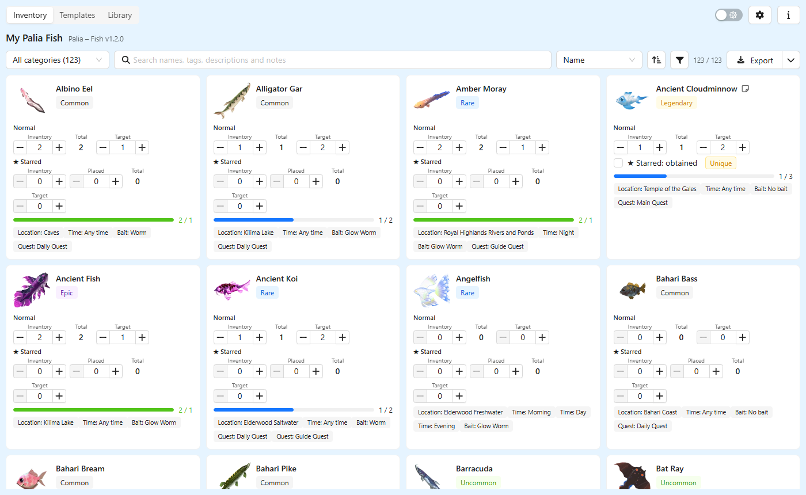

The toolbar at the top has:

- **Inventory | Templates | Library**: switches between the three views. The app remembers the last view and the last opened save and template.
- **Light/dark switch** (sun/moon): changes the theme.
- **⚙ Settings**: program settings (see below).
- **ⓘ**: shows the About dialog.

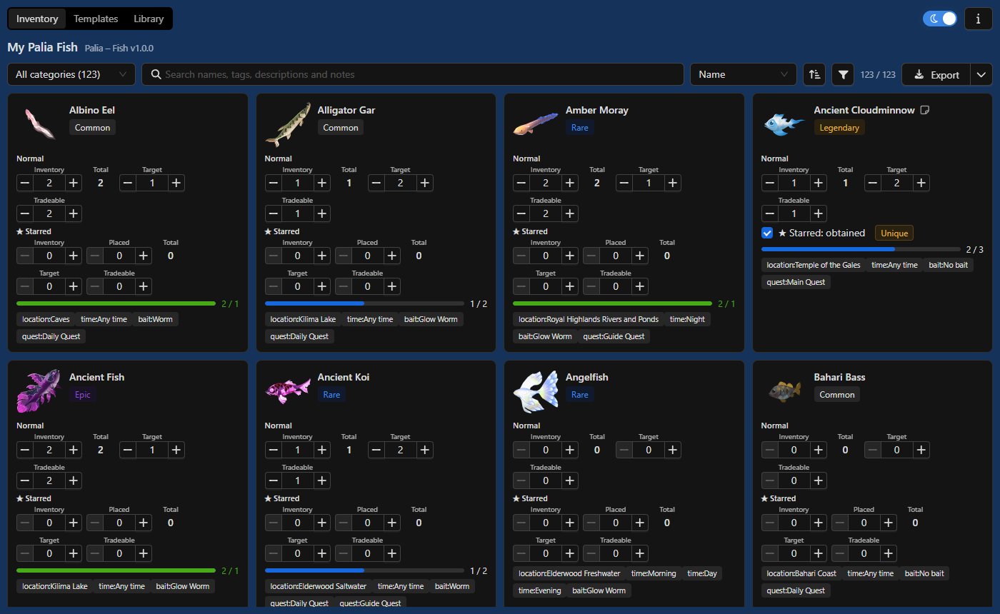

### 2.1 Settings and language

The **⚙** button opens the settings. **Language** switches the program between **English** and **Suomi** (Finnish). The change applies immediately and is remembered in this browser. The program starts in English until you choose another language.

Only the program's own texts are translated. Names, descriptions, tags, counter labels and other contents of templates and saves stay as they were written. **Add common counters** in a template creates the counters with labels in the current language.

## 3. Getting started

1. Open the **Library**. On first use it is empty.

   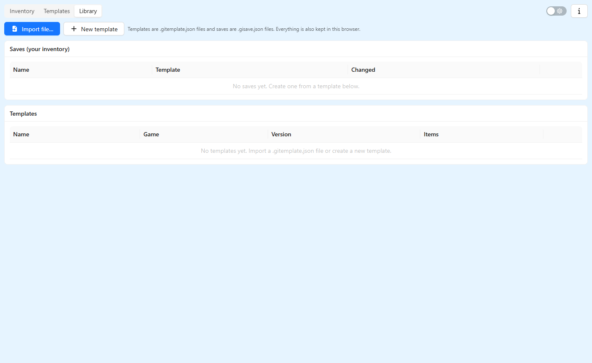

2. Get a template:
   - **Online templates…** and **Install** a template shared by the community (see [Online templates](#41-online-templates)), or
   - **Import file…** and choose one or more `.gitemplate.json` files, or
   - **New template** to make your own (see [Templates](#8-templates-defining-a-games-items)).

   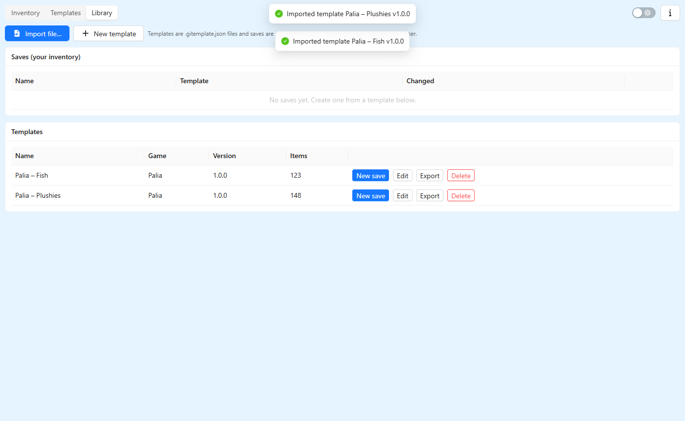

3. Click **New save** on a template row, give the save a name and click **Create**.

   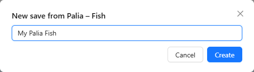

4. The save opens in the **Inventory** view. Start counting.

## 4. Library

The Library lists everything stored in this browser.

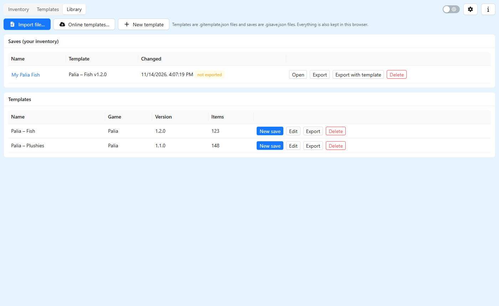

**Saves (your inventory)**

| Column / button | Meaning |
|---|---|
| Name | Click to open the save |
| Template | The template name and version. A blue **vX available** tag means a newer version of the template has been imported. A red **template missing** tag means the template has to be imported before the save can be opened. |
| Changed | Last change time. An orange **not exported** tag means there are changes that are not in an exported file yet. |
| Open | Opens the save in the Inventory view |
| Export | Downloads the save as a `.gisave.json` file |
| Export with template | Downloads the save with its template embedded, so one file is enough to move it to another device |
| Delete | Deletes the save after confirmation. This cannot be undone. |

**Templates**

| Button | Meaning |
|---|---|
| New save | Creates a save from this template version |
| Edit | Opens the template in the Templates view |
| Export | Downloads the template as a `.gitemplate.json` file |
| Delete | Deletes this template version. You are warned if saves use it. |

**Import file…** accepts both templates and saves, several at a time. The app reads the `format` field inside the file, so a renamed file is still recognized. If the same template version or save already exists, you are asked whether to replace it. Importing a save that has an embedded template also imports the template when it is missing.

### 4.1 Online templates

**Online templates…** lists the templates shared in the
[community template repository](https://github.com/VPKSoft/game-item-tracker-data). It needs an internet
connection; everything else in the app works offline.

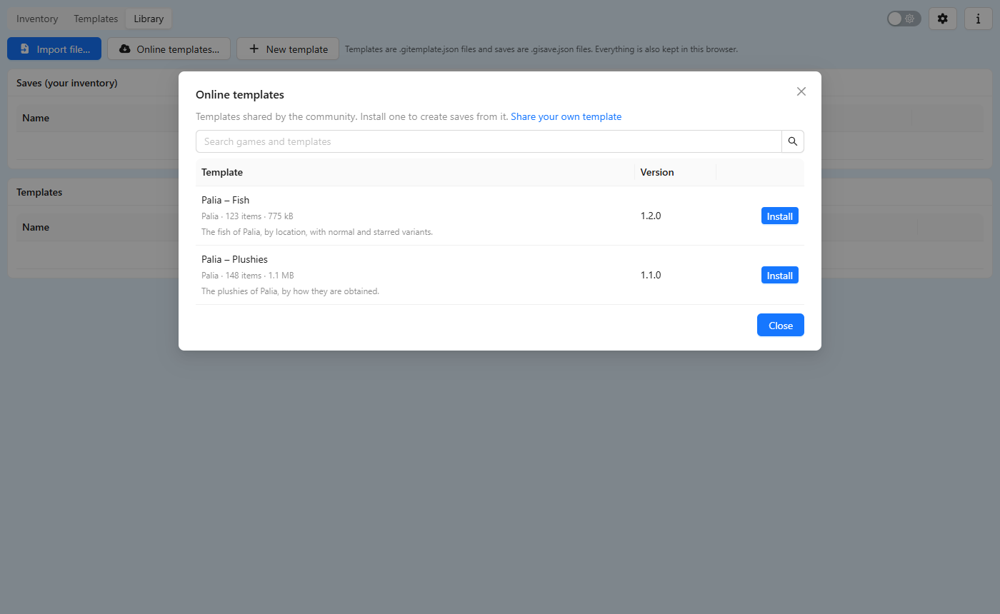

- Type in the search field to find a game or template.
- **Install** downloads the template into the Library. Then create a save from it with **New save**.
- **Update to vX** appears when a newer version of a template you have is available. After updating, open
  your save and use the upgrade banner to move it to the new version (see
  [Template versions and save upgrades](#9-template-versions-and-save-upgrades)).
- **Installed** means you already have that version. **older than yours** means your library has a newer
  version than the online one, for example because you edited it yourself.

To share a template of your own, export it (**Export** on its row in the Library) and follow **Share your own template** in the dialog. It opens a submission form on GitHub where you attach the exported file; you need a free GitHub account, but no git. Once a maintainer has added the template, it appears in this list for everyone.

## 5. Inventory: tracking your items

The Inventory view shows the open save as a grid of item cards. The header shows the save name and its template and version.

### 5.1 Item cards

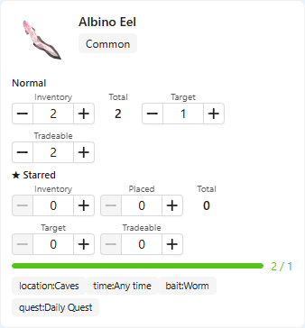

Each card shows:

- The item image, name and attribute badges (e.g. *Common*, *Legendary*).
- One counter row per **variant** (e.g. *Normal* and *★ Starred*). Items without variants have a single row.
- **Manual counters** as `− [n] +` steppers. **Computed counters** (e.g. *Total*) are plain read-only numbers.
- A **progress bar** with *owned / target* when the template has those roles. It turns green when the target is reached.
- The item's effective tags (up to six, then *+N*).
- A note icon next to the name when the item has notes. Hover over it to read them.

Changing amounts:

- Click **+** or **−** to change by 1.
- **Shift-click** + or − to change by 10.
- Click the number to type a value directly.
- Values never go below 0, or above a counter's maximum when the template sets one.

### 5.2 Item details drawer

Click a card (outside the counters) to open its details.

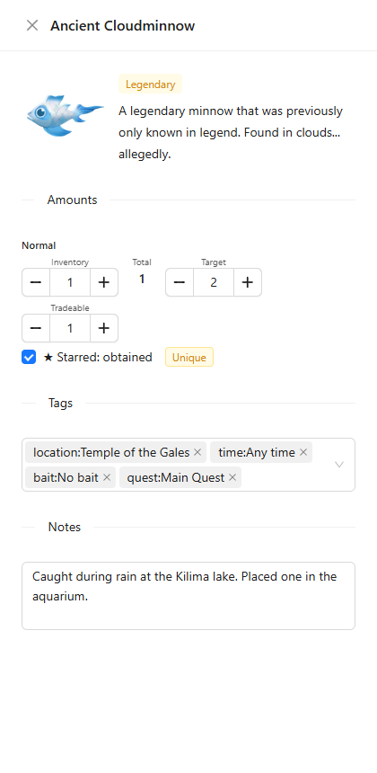

The drawer contains:

- **Amounts**: the same counters and obtained checkboxes as on the card, in a larger size.
- **Tags**: the item's tags. You can remove tags that came from the template, add them back, and add your own tags. Template tags you removed stay removed even after a template upgrade, and tags added in a newer template version still appear.
- **Notes**: free text. Notes are saved when the field loses focus and are included in the quick search.

### 5.3 Exporting from the Inventory view

The **Export** button in the toolbar downloads the save. The arrow next to it offers **Export with template**.

### 5.4 Items removed from the template

A template upgrade never deletes items from your save. If the new template version no longer has an item, the item stays in the save and is marked as removed. The Inventory view then shows a warning, **N items in this save no longer exist in the template**, with a **Review…** button. The dialog lists those items with the version that removed them, their amounts and notes. Click **Remove** next to an item, or **Remove all**, and confirm to delete them from the save. Until then their data is kept and exported with the save.

### 5.5 Exchange list: sharing what you give and need

The exchange list is a quick way to tell other players which items you can give and which you are looking for. You pick the items and get a compact image of small squares, each with the item image, its name and the amount. You can paste the image into Discord or another chat app, or save it as a PNG file.

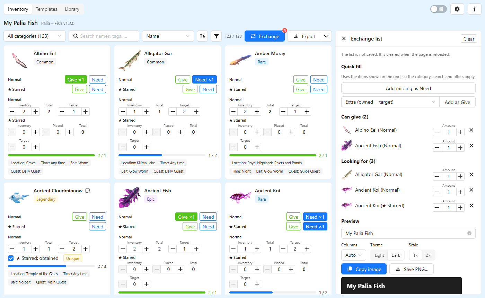

1. Click **Exchange** in the Inventory toolbar. The exchange list panel opens next to the grid (the grid narrows to make room), and every item card shows **Give** and **Need** buttons for each variant.
2. Add items in one of two ways:
   - Click **Give** or **Need** on a card. The button turns solid and shows the amount (e.g. *Need ×2*). Click it again to remove the item.
   - Use **Quick fill** in the panel. **Add missing as Need** adds every item where *target − owned* is above zero. **Add as Give** adds the items you have extra of: *owned − target* by default, or the value of a counter you pick, such as *Tradeable*. Quick fill uses only the items the grid shows, so choose a category, search or filter first to limit it.
3. Change amounts with the steppers in the panel, or remove lines with **×**. **Clear** empties the list.
4. Set the image title (the save name by default), the number of columns, a light or dark theme, and the scale (*2×* is sharper on high-resolution screens).
5. Click **Copy image** and paste it into the chat, or **Save PNG…** to save a file.

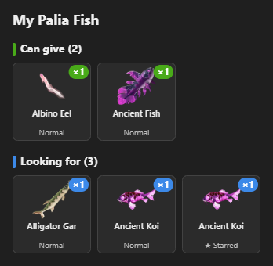

Notes:

- Amounts are suggested from your counters when you add an item, and they are always at least 1.
- A unique item or variant can only be added as *Need*, and Quick fill adds it only while it is not obtained.
- The list is **not saved**. It stays while the app is open, including when you switch views, and is cleared when the page is reloaded. Each save has its own list.
- **Copy image** is hidden in browsers that cannot copy images to the clipboard. Use **Save PNG…** there.

## 6. Finding items: categories, search, sorting and filters

The same toolbar is used in the Inventory and Templates views. The item count on the right shows *visible / total*.

### 6.1 Categories

The first drop-down lists **All categories** and each category with its item count. Sub-categories are indented.

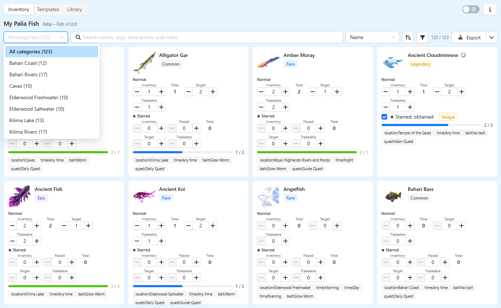

### 6.2 Quick search

Type in the search field to search **names, tags, descriptions and notes** at the same time. The search is fuzzy, so small typos still find the item. While a search is active, the results are sorted by **relevance** until you pick another sort.

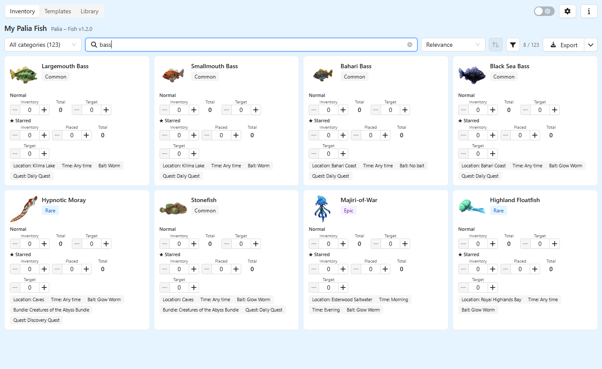

### 6.3 Sorting

The sort drop-down offers:

- **Name**
- Each numeric **attribute** (e.g. *Rarity*)
- **Missing** (target − owned), when the template has owned and target counters
- Each **counter** (e.g. *Inventory*, *Placed*, *Total*). These use the total across all variants of the item.
- **Relevance**, while searching

The arrow button next to it switches between ascending and descending order.

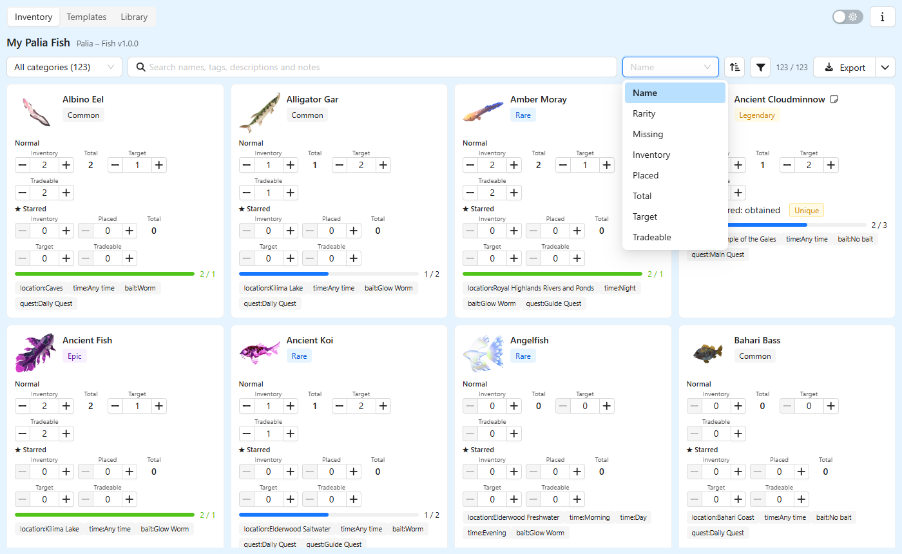

### 6.4 Filters (Inventory view)

The funnel button opens the filters. A badge shows how many are active.

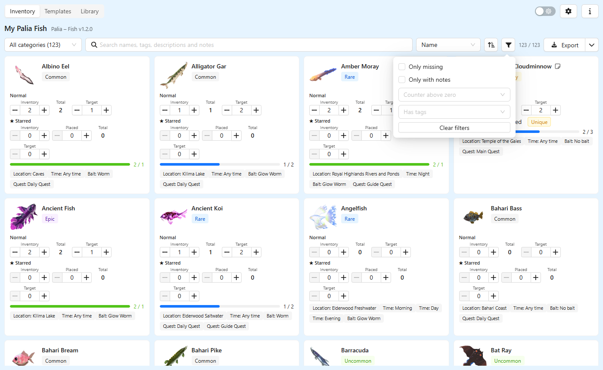

- **Only missing**: items where owned is below target.
- **Only with notes**: items that have notes.
- **Counter above zero**: e.g. *Tradeable > 0* to see what you can trade or give away.
- **Has tags**: items that have the chosen tags.
- **Clear filters** resets all of them.

The category, sort and filter choices are remembered per save and per template.

## 7. Unique items

Some items exist only once in a game: you either have them or you don't, so counting makes no sense. In Palia, the **★ Starred Ancient Cloudminnow** is such an item. The normal Ancient Cloudminnow can be caught many times, but the starred one is unique.

A template can mark:

- **the whole item** as unique, or
- **only some variants** of it, as in the Cloudminnow example.

### 7.1 In a save

For a unique variant the card shows an **obtained** checkbox and a gold **Unique** tag instead of the counter steppers. Other variants of the same item keep their normal counters.

| Not obtained yet | Obtained |
|---|---|
| 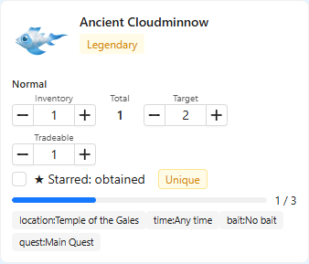 | 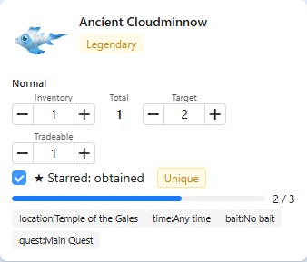 |

For an item that is unique as a whole, the checkbox is just labeled **Obtained**. For a unique variant it is labeled with the variant, e.g. **★ Starred: obtained**.

How unique variants count:

- In the **progress bar**, the **Missing** sort and the **Only missing** filter, a unique variant counts as target 1 and owned 1 when obtained (0 when not).
- For counter sorts and the *Counter above zero* filter, the owned counter (e.g. *Total*) is 1 when obtained and the target counter is 1. Other counters, such as *Inventory* or *Tradeable*, are 0 for a unique variant.
- The obtained state is stored in the save, so it is kept in exports and template upgrades.

### 7.2 In a template

In the template item drawer, switch on **Unique**. If the item has variants, tick the variants that are unique (e.g. only *★ Starred*). If the item has no variants, the whole item becomes unique.

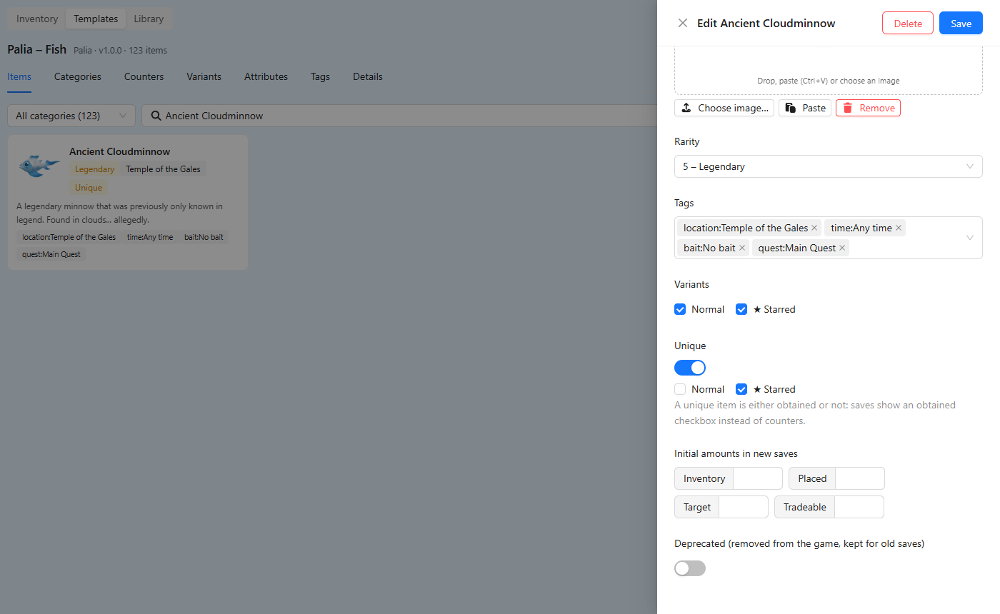

Unique items show a gold **Unique** badge on their cards in the Templates view.

## 8. Templates: defining a game's items

Open a template with **Edit** in the Library, or create one with **New template**.

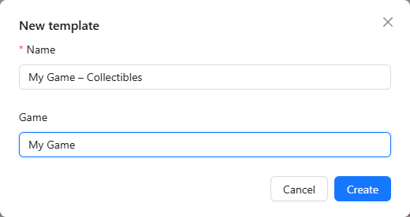

The Templates view has a header with the template name, game, version and item count, and an **Export** button. The editor is split into tabs. Every change is saved to the browser automatically.

### 8.1 Items

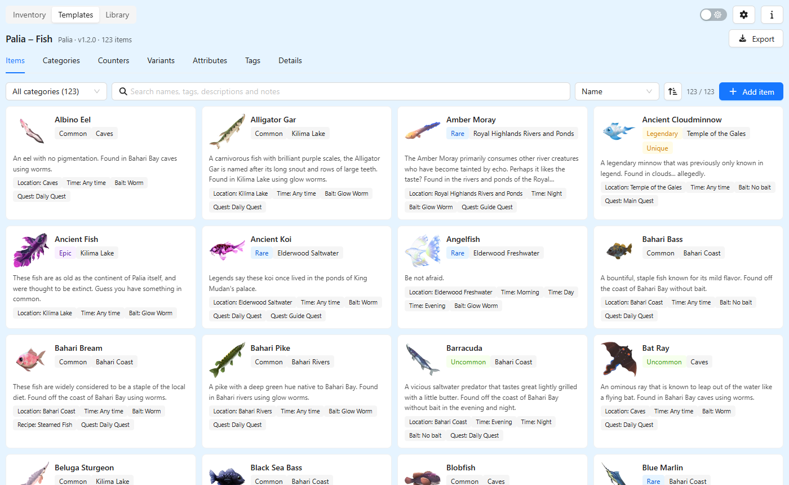

The Items tab uses the same category, search and sort toolbar as the Inventory view. Cards show the description and badges instead of counters. **Add item** creates a new item (add a category first). Click a card to edit it.

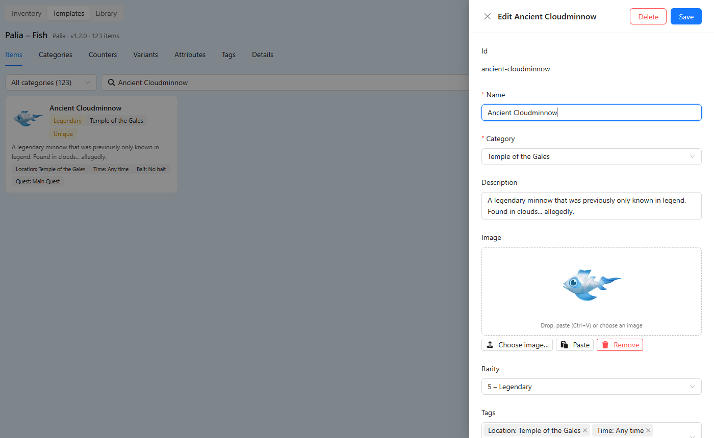

The item drawer fields:

| Field | Meaning |
|---|---|
| Id | The stable id of the item that saves use to find it. It does not change when you rename the item. |
| Name, Category, Description | Shown on the cards and searched |
| Image | See [Adding images](#82-adding-images) |
| Attributes | One input per attribute, e.g. *Rarity: 5 – Legendary* |
| Tags | Choose from the template's tags or type new ones |
| Variants | Which of the template's variants apply to this item |
| Unique | Makes the item, or some of its variants, unique (see [Unique items](#7-unique-items)) |
| Initial amounts in new saves | Default counter values, e.g. a target of 1 |
| Deprecated | The item was removed from the game but is kept for old saves |

Click **Save** to store the item, or **Delete** to remove it.

### 8.2 Adding images

An item image can be added in three ways:

- **Choose image…** opens a file picker.
- **Drag and drop** an image file onto the drop area.
- **Paste** with Ctrl+V while the drawer is focused, or with the **Paste** button.

The image is shown in a preview with its original size and the size it will be stored at. It is resized only when you click **Accept**: to at most 128 × 128 px, as WebP. **Cancel** keeps the current image. Files over 10 MB are rejected.

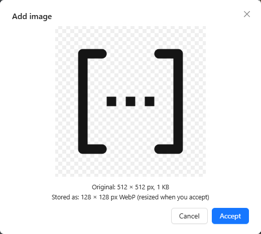

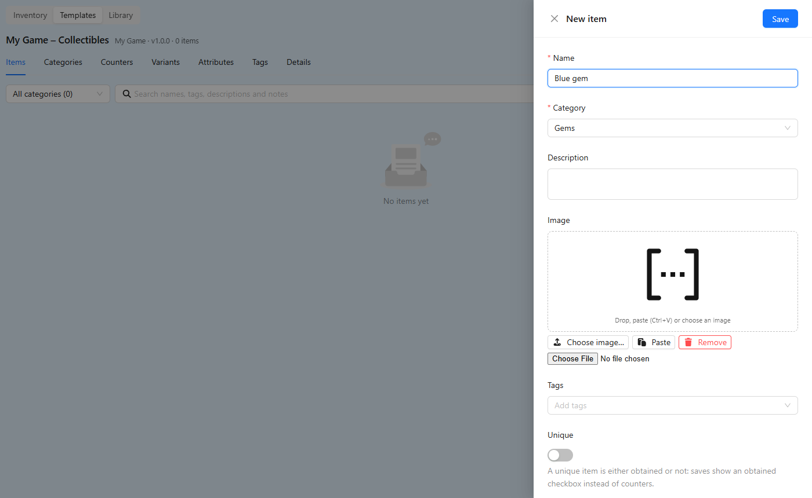

### 8.3 Categories

Add, rename and reorder categories and choose a parent to make sub-categories. The table shows how many items each one has. When you delete a category that has items, you choose another category to move them to.

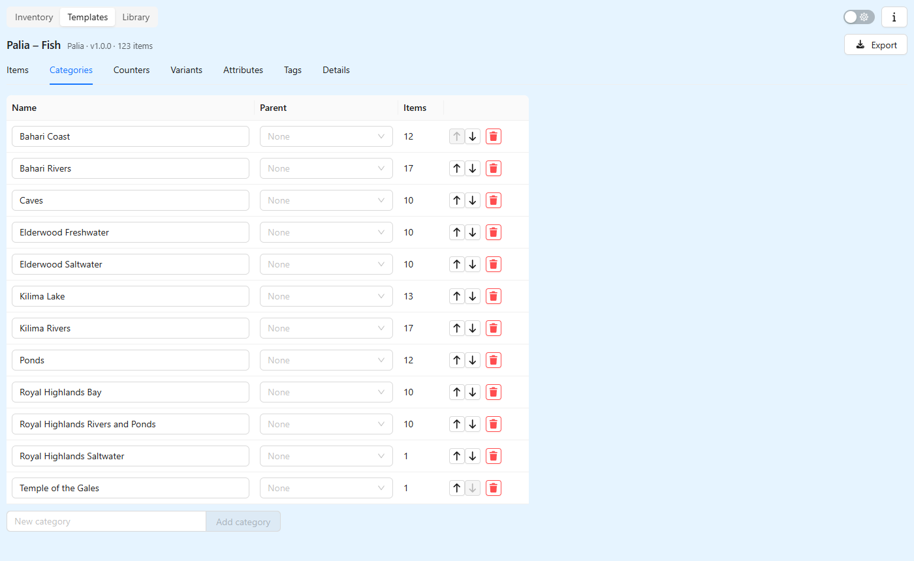

### 8.4 Counters

A new template has no counters. Click **Add common counters** to start with *Inventory, Placed, Storage, Total, Target and Tradeable*, or add your own with **Add counter**.

| Empty template | After *Add common counters* |
|---|---|
| 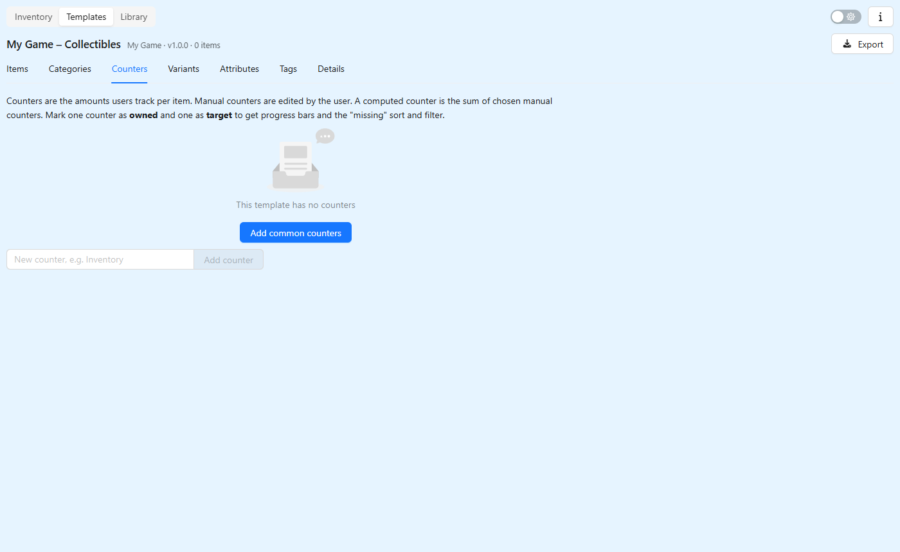 | 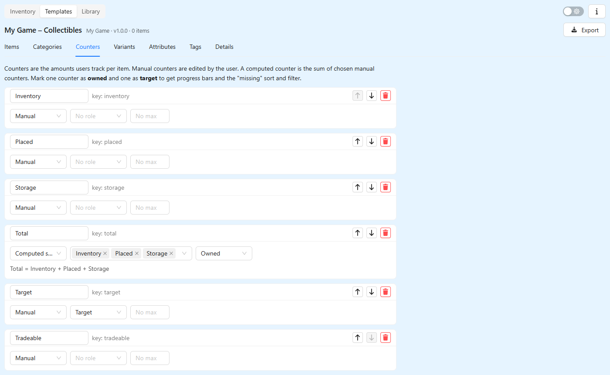 |

Each counter has:

- **Label** (and a fixed key used in files)
- **Type**: *Manual* or *Computed sum*. For a computed counter, pick the manual counters to add up. A formula such as *Total = Inventory + Placed* is shown below it.
- **Role**: *Owned* or *Target* (at most one of each)
- **Variants**: limit the counter to some variants, e.g. *Placed* only for *★ Starred*. Empty means all variants.
- **Max**: an optional upper limit for manual counters
- Move up/down and delete buttons. Deleting a counter hides its values in saves; they are not lost.

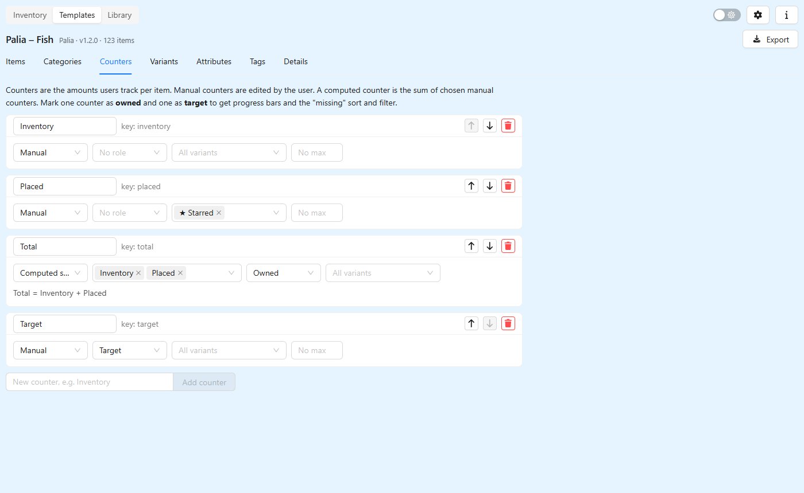

### 8.5 Variants

Add, rename, reorder and delete variants, e.g. *Normal* and *★ Starred*. Each item chooses which variants apply in its drawer.

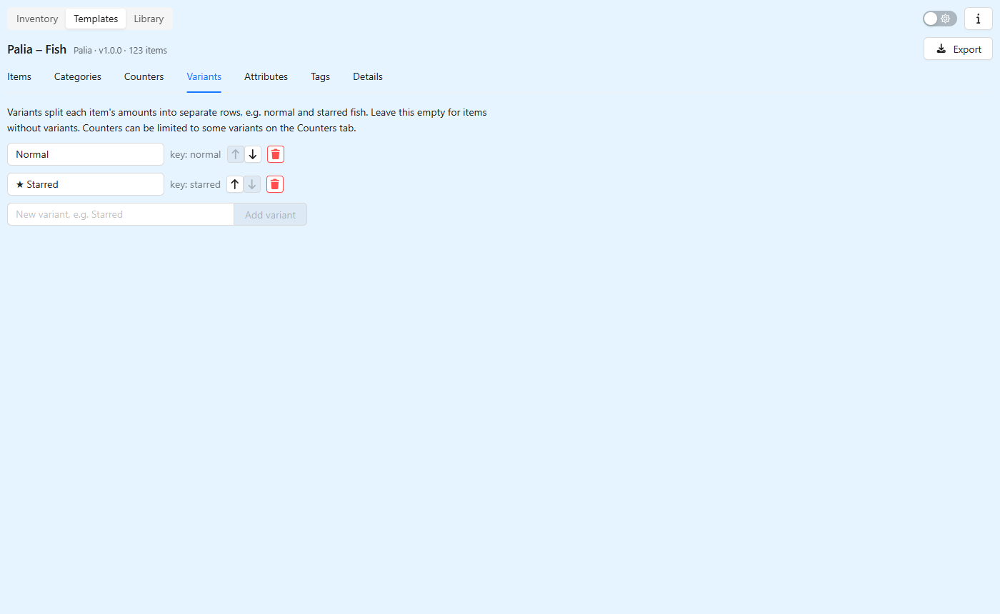

### 8.6 Attributes

Attributes are read-only numbers in saves, such as rarity. Each has a label, a minimum and maximum, and optional named **levels** (e.g. *1 = Common … 5 = Legendary*), which are shown as colored badges.

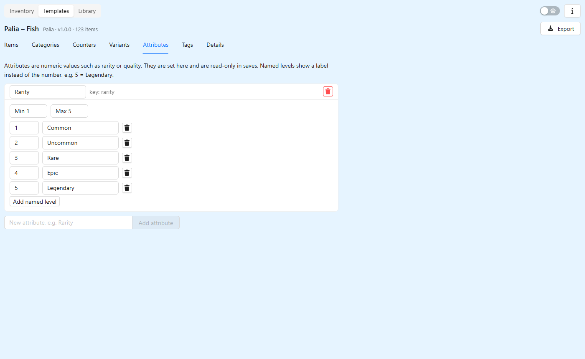

### 8.7 Tags

The tag vocabulary of the template, with the number of items that use each tag. You can filter, add, rename and remove tags. Renaming a tag to an existing tag merges the two. Removing a tag removes it from every item.

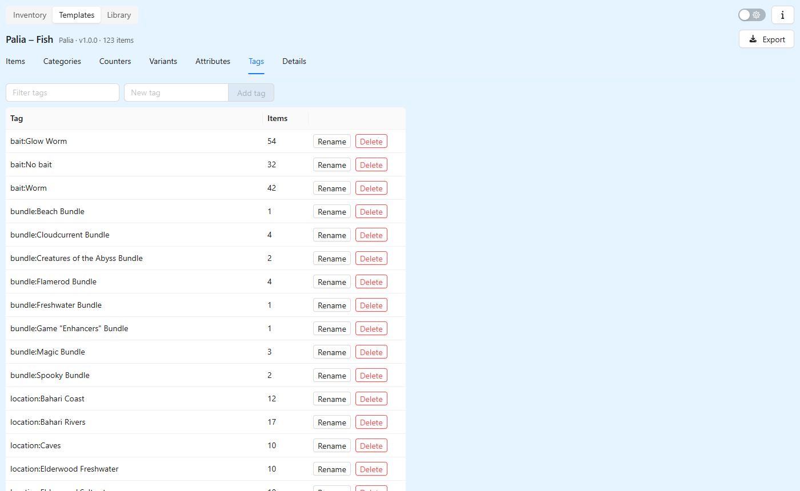

### 8.8 Details

The Details tab holds the template's name, game, description, source/attribution (name, URL, license) and version. It also lists validation problems, such as missing categories or invalid counter formulas. The tab shows a badge with the number of problems, and exporting a template that has problems asks for confirmation.

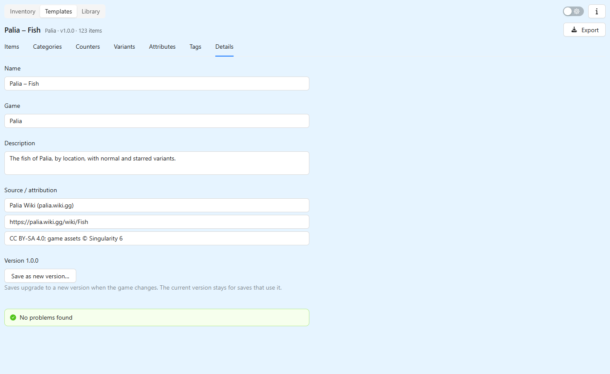

## 9. Template versions and save upgrades

When the game gets an update, update the template instead of starting over:

1. Open the template and go to **Details**.
2. Click **Save as new version…** and choose **Patch** (fixes), **Minor** (new items) or **Major** (big changes). The old version stays in the library for the saves that use it.
3. Edit the new version, then export it and share it if others use it.

When a save's template has a newer version in the library, the Inventory view shows **A newer template version is available** with an **Upgrade…** button. The upgrade dialog lists what will change:

- **New items, counters and variants** start at their initial amounts, or 0.
- **Items deleted from the template** are kept in the save and marked as removed (see [5.4](#54-items-removed-from-the-template)). Deprecated items with data are kept as well.
- **Removed counters and variants** are shown in a warning that tells how many items have values for each of them. Their values are hidden, not deleted, and reappear if a later version brings them back. Tick **Discard the hidden values of removed counters and variants** to delete them instead; the upgrade then asks for confirmation before deleting values you have entered.
- Name, description, category, attribute, image and formula changes apply automatically.

Upgrades only go forward.

## 10. Files, storage and backups

- Everything is stored in the browser's **IndexedDB** and saved automatically about half a second after each change. You do not need to save before closing the tab.
- The app asks the browser for persistent storage, so the data is not removed when disk space runs low. Clearing the site data in the browser does remove it.
- Files are plain JSON with a double extension that tells the role: `my-game.gitemplate.json` and `my-save.gisave.json`. They can be opened in any text editor.
- **Back up regularly** with Export. The *not exported* tag in the Library shows saves and templates with unexported changes.
- To move a save to another device or browser, use **Export with template** and import the file there.

## 11. Tips and keyboard shortcuts

| Action | How |
|---|---|
| Change a counter by 10 | Shift-click **+** or **−** |
| Type an amount | Click the number on the stepper |
| Paste an item image | Ctrl+V in the template item drawer |
| See what you can trade | Filter *Counter above zero* → *Tradeable > 0* |
| See what you still need | Filter *Only missing*, or sort by *Missing* (descending) |
| Post your trade list in Discord | **Exchange** → **Add missing as Need** / **Add as Give** → **Copy image**, then paste |
| Find a fish by its bait or location | Type the bait or location in the search field (tags are searched) |

## 12. Troubleshooting

| Problem | Solution |
|---|---|
| *No save is open* in the Inventory view | Open a save from the Library, or create one from a template |
| *template missing* tag on a save | Import the template version the save uses (or a save exported with its template) |
| An import shows an error | The file is not a valid template or save. The message names the file and the problem. |
| The progress bar or *Missing* sort is not shown | The template needs one counter with the *Owned* role and one with the *Target* role |
| *Add item* is disabled | Add a category in the Categories tab first |
| Data disappeared after clearing the browser | Import your last exported files. Export regularly to avoid this. |
